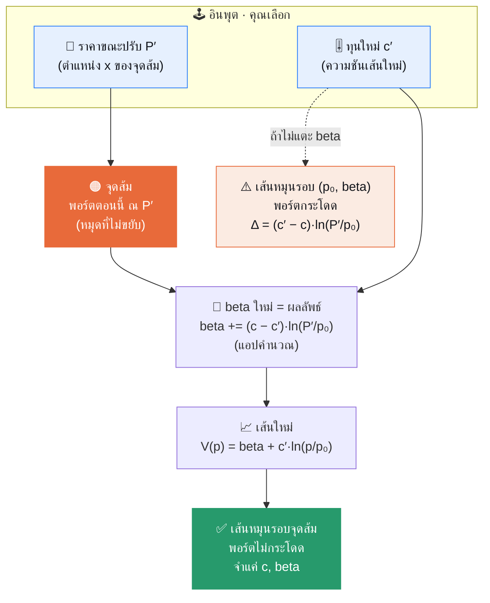

# 🎯 Rebalancing Playground — Key Final

> [!IMPORTANT]
> **ปรับ “ทุน” = หมุนเส้นรอบจุดส้ม ไม่ใช่ยกเส้นทั้งเส้น**
> จุดส้มคือ *มูลค่าพอร์ตตอนนี้* — มันไม่ขยับ พอร์ตจึงไม่กระโดด · `beta` คือผลลัพธ์ที่แอปคำนวณมาชดเชย

ต้นฉบับ: [`rebalancing_playground.html`](rebalancing_playground.html) · ไดอะแกรม: [`rebalancing_playground.mmd`](rebalancing_playground.mmd) · เปิดแอปได้ที่แท็บ **Web Apps** ของ Manual Test Lab

## 🔑 Key final

1. **ค่าพอร์ต = เส้น** `V(p) = beta + c·ln(p/p₀)` — ทุน `c` ยิ่งมาก เส้นยิ่งชัน
2. **ปรับทุน = หมุนเส้นรอบจุดส้ม** — จุดไม่ขยับ = พอร์ตไม่กระโดด (นี่คือ *dynamic*)
3. **`P′` คืออินพุต · `beta` คือผลลัพธ์** — คุณลาก `c′` กับ `P′` ส่วน `beta` แอปคำนวณให้ (`beta` ไม่ใช่ราคา `p` ไม่ใช่ `P′` และไม่ใช่จุดส้ม)
4. **`beta += (c − c′)·ln(P′/p₀)`** — ค่าที่เพิ่มคือลบของระยะที่เส้นจะกระโดดพอดี จึงหักล้างหมด
5. **จำน้อยลง** — ตามหน้าเว็บ แบบเดิมต้องจำ `t, c, beta` แบบนี้จำแค่ `c, beta` (ตรึง `p₀`) และผลเท่ากันทุกจุด

## 🔤 สัญลักษณ์ — คนละตัวกัน

| ตัว | คืออะไร | ใครกำหนด |
|---|---|---|
| `p` | ราคา (แกนนอน) — ตัวแปรของเส้น | — |
| `p₀` | ราคาอ้างอิงที่ตรึงไว้ = 100 | ตรึงในแอป |
| `P′` | **ราคาขณะปรับ** = ตำแหน่ง x ของจุดส้ม (55–165) | **คุณเลือก** |
| `c` / `c′` | **ทุน** เดิม / ใหม่ = ความชันของเส้น (`c′`: 40–240) | `c′` **คุณลาก** |
| `beta` | **ระดับของเส้น** = ความสูงของเส้นที่ `p = p₀` (แกนตั้ง) | **แอปคำนวณ** |
| 🟠 จุดส้ม | `(P′, beta เดิม + c·ln(P′/p₀))` = พอร์ตตอนนี้ ณ `P′` — ขยับตาม `P′` ไม่ขยับตาม `c′` | ตามจาก `P′` |

แถบ “ค่าปัจจุบัน” ในแอป (`beta · c · P′`) คือบันทึกของการปรับครั้งล่าสุด — สามค่าแยกกัน

## 🧠 คิดง่ายๆ

ไม้บรรทัดที่ **ปักหมุดไว้จุดเดียว** — บิดให้ชันขึ้นหรือราบลงได้ แต่หมุดไม่ขยับ
หมุด = 🟠 จุดส้ม · บิด = ลาก `c′` · เลื่อนให้ผ่านหมุดพอดีหลังบิด = `beta`

## 🔄 Flow



## 🧮 สมการและตัวอย่าง

```
V(p)       = beta + c · ln(p / p₀)                  เส้นพอร์ต
beta ใหม่  = beta เดิม + (c − c′) · ln(P′ / p₀)      เมื่อเปลี่ยนทุน c → c′ ที่ราคา P′
```

ถ้า `beta = 0` เหลือ `c·ln(p/p₀)` หน้าตาเดียวกับ `Rₙ = Fix_c · ln(Pₙ/P₀)` ใน Rebalancing 101

**ตัวอย่าง** — ปุ่ม “ลองตัวอย่าง”: ทุน 100 → 200 ที่ราคา 120 เริ่มจาก `beta = 0`
`beta` ใหม่ = 0.00 + (100 − 200)·ln(120/100) = 0.00 − 18.23 = **−18.23**
เช็ก: จุดส้ม = 100·ln 1.2 = **18.23** · เส้นใหม่ที่ราคา 120 = −18.23 + 200·ln 1.2 = **18.23** ✓ เท่ากัน

| ราคา `p` | เส้นเดิม (c=100) | เส้นใหม่ (c′=200) | |
|---:|---:|---:|---|
| 80 | −22.31 | −62.86 | ต่ำลง |
| **120** | **18.23** | **18.23** | จุดส้ม — เท่าเดิม |
| 160 | 47.00 | 75.77 | สูงขึ้น |

**Sanity & edge**
- ที่มา: บังคับให้เส้นใหม่ผ่านจุดเดิม `beta′ + c′·ln(P′/p₀) = beta + c·ln(P′/p₀)` แล้วแก้หา `beta′`
- ถ้าไม่แตะ `beta` (เปลี่ยนแค่ `c`) เส้นจะหมุนรอบ `(p₀, beta)` → ที่ `P′` พอร์ตกระโดด `(c′ − c)·ln(P′/p₀)` = +18.23 ในตัวอย่าง (18.23 → 36.46) ตรงข้ามกับ beta ที่ปรับ (−18.23) พอดี
- `beta` ไม่ขยับเมื่อ `c′ = c` (ไม่ว่า `P′` เท่าไร) หรือ `P′ = p₀` (ไม่ว่าทุนเท่าไร เพราะ `ln 1 = 0`) — ทุน 100 → 200 ที่ `P′` = 80 / 100 / 120 / 140 ได้ beta = +22.31 / 0.00 / −18.23 / −33.65
- ราคาต้อง `> 0` (ln ไม่นิยามที่ ≤ 0) หน้าเว็บจึงจำกัด `P′` ไว้ 55–165
- กด “ยืนยันการปรับ” เพื่อตรึง `c′` กับ `beta` ใหม่เป็นเส้นปัจจุบัน สเต็ปถัดไปหมุนรอบเส้นล่าสุด: `beta` = ผลรวมสะสมของ `(c_ก่อน − c_หลัง)·ln(P′/p₀)` ทุกสเต็ป — ตรวจด้วยสคริปต์ปรับสุ่ม 10,000 ครั้ง ค่า ณ จุดปรับไม่เปลี่ยน (คลาดเคลื่อน < 10⁻¹²)

> [!NOTE]
> **หลักการที่ซ่อน — ความต่อเนื่องด้วยการตรึงจุด:** เส้นพอร์ตมีอิสระ 2 ค่า (`c` ความชัน, `beta` ระดับ) การตรึงให้ผ่านจุดส้มใช้ไป 1 เงื่อนไข เหลืออิสระจริงแค่ 1 ค่า — เลือก `c′` แล้ว `beta` ถูกกำหนดเอง และ `beta` เก็บการชดเชยของทุกสเต็ปไว้ในตัวเลขเดียว จึงจำแค่ `c, beta` ก็พอ

---

หมายเหตุ: “เส้น” จริง ๆ คือเส้นโค้ง ln — เป็นเส้นตรงบนแกน `ln p` และ `c` คือความชันบนแกนนั้น · แปลนเต็ม + โค้ด `BetaCalculator.tsx` ตาม footer ของหน้าเว็บอยู่ที่ `dynamic-rebalancing-calculator/SKILL.md` ซึ่ง **ไม่อยู่ในรีโปนี้** และหน้าเว็บไม่ได้นิยาม `t` ของแบบเดิม
