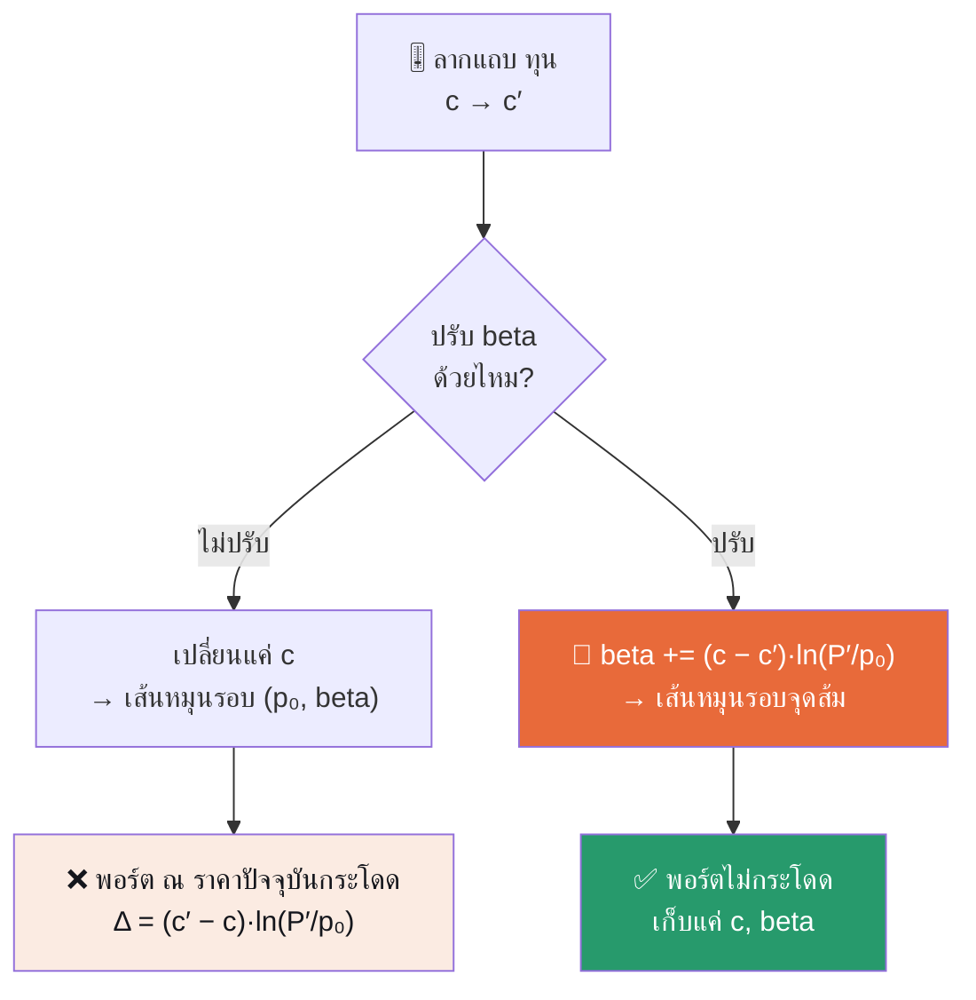

# 🎯 Rebalancing Playground — Key Message

> [!IMPORTANT]
> **ปรับ “ทุน” = หมุนเส้นรอบจุดส้ม ไม่ใช่ยกเส้นทั้งเส้น**
> จุดส้มคือ *มูลค่าพอร์ตตอนนี้* — มันไม่ขยับ พอร์ตจึงไม่กระโดด และงานของ `beta` คือรักษาเงื่อนไขนี้

ต้นฉบับ: [`rebalancing_playground.html`](rebalancing_playground.html) · เปิดได้ที่แท็บ **Web Apps** ของ Manual Test Lab

## 🧠 คิดง่ายๆ

ไม้บรรทัดที่ **ปักหมุดไว้จุดเดียว** — บิดให้ชันขึ้นหรือราบลงได้ แต่หมุดไม่ขยับ

| ในชีวิตจริง | ในหน้าเว็บ |
|---|---|
| หมุด | 🟠 จุดส้ม = มูลค่าพอร์ต ณ ราคาปัจจุบัน |
| บิดไม้บรรทัด | ลากแถบ **ทุน** `c → c′` (เปลี่ยนความชัน) |
| เลื่อนไม้บรรทัดให้ผ่านหมุดพอดีหลังบิด | `beta` ปรับตัวชดเชย |

## 📌 ใจความ 3 ข้อ

| # | ใจความ | แปลว่า |
|---|---|---|
| 1 | **ค่าพอร์ต = เส้น** บนกราฟราคา | ทุน `c` ยิ่งมาก เส้นยิ่งชัน |
| 2 | **ปรับทุน = หมุนเส้นรอบจุดปัจจุบัน** | จุดไม่ขยับ = มูลค่าพอร์ตไม่กระโดด — นี่คือ *dynamic* |
| 3 | **จำน้อยลง** | เดิมจำ `t, c, beta` → ตอนนี้จำแค่ `c, beta` (ตรึง `p₀`) · หน้าเว็บระบุว่าผลเท่ากันทุกจุด |

> [!NOTE]
> “เส้น” จริง ๆ คือเส้นโค้ง ln — โค้งเล็กน้อยบนแกนราคาปกติ แต่เป็นเส้นตรงบนแกน `ln p` และ `c` คือความชันบนแกนนั้น

## 🔄 ทำไมต้องมี beta



## 🧮 สมการ

```
V(p)       = beta + c · ln(p / p₀)                  เส้นพอร์ต (หน้าเว็บตรึง p₀ = 100)
beta ใหม่  = beta เดิม + (c − c′) · ln(P′ / p₀)      เมื่อเปลี่ยนทุน c → c′ ที่ราคา P′
```

`beta` = ค่าของเส้นที่ `p = p₀` (เพราะ `ln 1 = 0`) · `P′` = ราคาขณะปรับ = ตำแหน่งจุดส้ม
· ถ้า `beta = 0` สมการเหลือ `c·ln(p/p₀)` หน้าตาเดียวกับ `Rₙ = Fix_c · ln(Pₙ/P₀)` ใน Rebalancing 101

**ตัวอย่าง** — ปุ่ม “ลองตัวอย่าง”: ทุน 100 → 200 ที่ราคา 120 เริ่มจาก `beta = 0`

| ขั้น | คำนวณ | ผล |
|---|---|---:|
| 1 | `beta` เดิม | 0.00 |
| 2 | (100 − 200) · ln(120/100) = −100 × 0.1823 | −18.23 |
| = | `beta` ใหม่ = 0.00 + (−18.23) | **−18.23** |

เช็ก: จุดส้ม = 100·ln 1.2 = **18.23** · เส้นใหม่ที่ราคา 120 = −18.23 + 200·ln 1.2 = **18.23** ✓ เท่ากัน

> [!TIP]
> กด “ลองตัวอย่าง” แล้วดู 3 ขั้นใต้กราฟ — ตรงกับตารางนี้

หมุนรอบจุดส้ม ไม่ใช่กระโดด:

| ราคา `p` | เส้นเดิม (c=100) | เส้นใหม่ (c′=200) | |
|---:|---:|---:|---|
| 80 | −22.31 | −62.86 | ต่ำลง |
| **120** | **18.23** | **18.23** | จุดส้ม — เท่าเดิม |
| 160 | 47.00 | 75.77 | สูงขึ้น |

ชันขึ้น = พอร์ตไวต่อราคามากขึ้นทั้งสองทาง (ขาลงเสียมากขึ้น ขาขึ้นได้มากขึ้น) โดย ณ ราคาปัจจุบันไม่มีอะไรเปลี่ยน

**Sanity & edge**
- ที่มาของสูตร: บังคับให้เส้นใหม่ผ่านจุดเดิม `beta′ + c′·ln(P′/p₀) = beta + c·ln(P′/p₀)` แล้วแก้หา `beta′`
- ถ้าไม่แตะ `beta` เส้นจะหมุนรอบ `(p₀, beta)` แทน → ที่ราคา `P′` พอร์ตกระโดด `(c′ − c)·ln(P′/p₀)` = +18.23 ในตัวอย่าง (18.23 → 36.46) และ `beta` ที่ปรับ (−18.23) คือค่าที่หักล้างพอดี
- `P′ = p₀` → `ln 1 = 0` → `beta` ไม่เปลี่ยน · `c′ = c` → ไม่มีอะไรเปลี่ยน · ราคาต้อง `> 0` (ln ไม่นิยามที่ ≤ 0) หน้าเว็บจึงจำกัด `P′` ไว้ 55–165
- ปรับต่อเนื่องหลายสเต็ป: `beta` = ผลรวมสะสมของ `(c_ก่อน − c_หลัง)·ln(P′/p₀)` ทุกสเต็ป — ตรวจด้วยสคริปต์ปรับสุ่ม 10,000 ครั้ง ค่า ณ จุดปรับไม่เปลี่ยน (คลาดเคลื่อน < 10⁻¹²)

## 🕹️ อ่านกราฟ

| องค์ประกอบ | ความหมาย |
|---|---|
| 🟠 จุดส้ม | มูลค่าพอร์ตตอนนี้ ณ ราคา `P′` บนเส้นที่ยืนยันแล้ว · **ไม่ขยับเมื่อลาก “ทุน”** ขยับเฉพาะเมื่อลาก “ราคาขณะปรับ P′” (เลื่อนไปตามเส้นเดิม) |
| 🔵 เส้นฟ้า / ┄ เส้นประเทา | เส้นใหม่ที่พรีวิวด้วย `c′` / เส้นที่ยืนยันแล้ว (โผล่เมื่อ `c′ ≠ c`) |
| แถบ “ทุนใหม่ c′” (40–240) | หมุนเส้น |
| ✓ “ยืนยันการปรับ” | ตรึง `c′` กับ `beta` ใหม่เป็นเส้นปัจจุบัน + บันทึกสเต็ป — สเต็ปถัดไปหมุนรอบเส้นล่าสุด |

> [!NOTE]
> **หลักการที่ซ่อน — ความต่อเนื่องด้วยการตรึงจุด:** เส้นพอร์ตมีอิสระ 2 ค่า (`c` ความชัน, `beta` ระดับ) การตรึงให้ผ่านจุดส้มใช้ไป 1 เงื่อนไข เหลืออิสระจริงแค่ 1 ค่า — เลือก `c′` แล้ว `beta` ถูกกำหนดเอง และ `beta` เก็บการชดเชยของทุกสเต็ปไว้ในตัวเลขเดียว จึงจำแค่ `c, beta` ก็พอ

---

แปลนเต็ม + โค้ด `BetaCalculator.tsx` ตาม footer ของหน้าเว็บอยู่ที่ `dynamic-rebalancing-calculator/SKILL.md` ซึ่ง **ไม่อยู่ในรีโปนี้** (และหน้าเว็บไม่ได้นิยาม `t` ของแบบเดิม)
